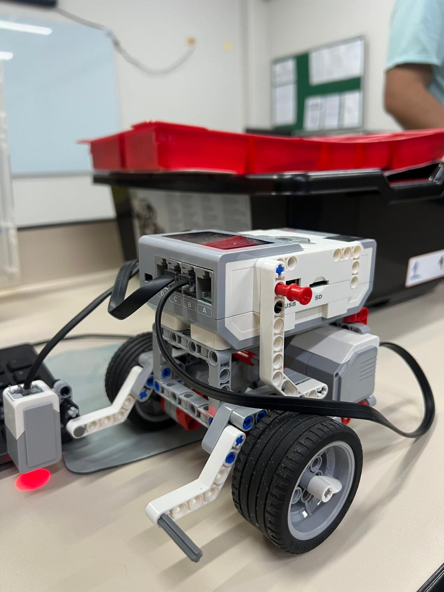
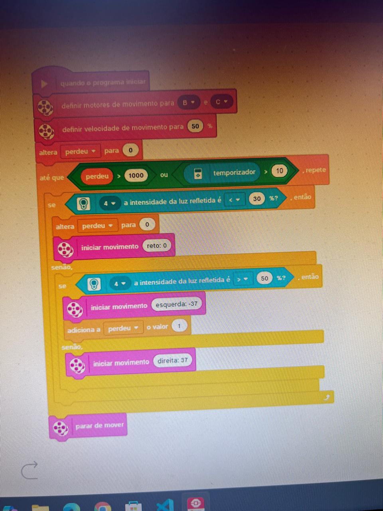

# Projeto 1 — Seguidor de Linha | Line Follower Robot

Projeto acadêmico desenvolvido na disciplina de **Oficina de Programação e Robótica LEGO MINDSTORMS EV3 STEAM**. O objetivo foi construir e programar um robô capaz de percorrer autonomamente uma linha preta de 2 metros.

An academic project developed as part of the **LEGO MINDSTORMS EV3 Programming and Robotics Workshop**. The goal was to build and program a robot capable of autonomously following a 2-meter black line.

## Demonstração | Demo

Clique na imagem para assistir ao robô percorrendo a pista.

Click the image to watch the robot follow the track.

[ Assistir ao vídeo completo | Watch the full video](./execucao.mp4)

## Objetivo | Objective

Desenvolver um robô capaz de identificar uma linha preta, acompanhar seu percurso e parar ao chegar ao final da pista. Caso perdesse a trajetória, o robô deveria ser capaz de se relocalizar e continuar a execução.

Build a robot capable of detecting and following a black line, stopping at the end of the track. If it lost the path, it should be able to relocate the line and continue.

## O Desafio | The Challenge

O desafio consistia em percorrer uma pista contendo uma linha preta de **2 metros**, utilizando sensores para identificar a trajetória e motores para controlar o deslocamento.

The challenge was to navigate a track containing a **2-meter black line**, using sensors to detect the path and motors to control movement.

O robô deveria | The robot had to:

- Detectar a linha preta | Detect the black line;
- Manter-se sobre a trajetória | Stay on the path;
- Corrigir seu deslocamento quando necessário | Correct its movement when necessary;
- Percorrer os 2 metros | Travel the 2 meters;
- Parar ao final do percurso | Stop at the end of the track.

## Hardware e Componentes | Hardware and Components

- **LEGO MINDSTORMS EV3** — unidade de controle | control unit;
- **Bloco EV3** — execução do programa | program execution;
- **Motores B e C** — movimentação e controle da trajetória | movement and path control;
- **Sensor de cor (Sensor 4)** — identificação da linha por meio da intensidade luminosa | line detection through reflected light intensity;
- **Rodas e peças LEGO** — estrutura e locomoção | structure and movement;
- **Cabos** — conexão entre os componentes | component connections.

## Lógica de Funcionamento | Operating Logic

O Sensor 4 realiza leituras da superfície para identificar a faixa preta. A partir dessas leituras, o programa utiliza estruturas de decisão para determinar o comportamento dos motores B e C.

Sensor 4 reads the track surface to identify the black line. Based on these readings, the program uses conditional structures to control motors B and C.

Durante o desenvolvimento, a estratégia passou por diferentes abordagens. Inicialmente, o robô realizava um movimento em **zigzag** para acompanhar a linha. Após testes e ajustes, a solução evoluiu para uma trajetória mais direta e estável.

During development, the movement strategy went through different approaches. Initially, the robot used a **zigzag** movement to follow the line. After testing and adjustments, the solution evolved into a more direct and stable path.

### Conceitos de Programação | Programming Concepts

- Sequência | Sequence;
- Estruturas condicionais | Conditional statements;
- Laços de repetição | Loops;
- Leitura de sensores | Sensor input;
- Controle de motores | Motor control;
- Lógica de controle de trajetória | Path control logic;
- Temporização | Timing.

## Desenvolvimento e Testes | Development and Testing

A solução foi desenvolvida de forma iterativa, com testes e ajustes na programação e na estrutura física do robô.

The solution was developed iteratively, with tests and adjustments to both the program and the robot's physical structure.

### Tentativa 1 | Attempt 1

O robô apresentava dificuldade para detectar corretamente a intensidade das cores e saía da trajetória.

The robot had difficulty detecting color intensity correctly and frequently left the path.

**Ajuste | Adjustment:** priorização do acompanhamento da faixa preta, utilizando movimentação em zigzag.

The strategy was adjusted to prioritize black-line tracking through zigzag movement.

### Tentativa 2 | Attempt 2

O robô conseguia acompanhar a linha, mas não realizava a parada corretamente ao final.

The robot could follow the line but did not stop correctly at the end.

**Ajuste | Adjustment:** utilização de uma estimativa de distância percorrida associada ao tempo de execução.

An estimate of traveled distance combined with execution time was used.

### Tentativa 3 | Attempt 3

A trajetória foi ajustada para um deslocamento mais direto, com refinamento do comando de parada.

The path was adjusted to achieve more direct movement, and the stopping command was refined.

**Resultado | Result:** missão cumprida | mission accomplished.

Além da programação, foram realizados ajustes na montagem para reforçar os encaixes das peças e melhorar a estabilidade do robô.

The robot's physical assembly was also adjusted to reinforce connections and improve stability.

## Conceitos Aplicados | Applied Concepts

**Programação e algoritmos | Programming and Algorithms**

- Sequência, condicionais e repetição | Sequence, conditionals, and loops;
- Sensoriamento | Sensor input;
- Controle de trajetória | Path control.

**Matemática e engenharia | Mathematics and Engineering**

- Medição de distância | Distance measurement;
- Cálculo de voltas das rodas | Wheel rotation calculations;
- Controle de velocidade | Speed control;
- Medição de ângulos | Angle measurement;
- Distribuição de peso | Weight distribution.

**Física | Physics**

- Atrito | Friction;
- Força | Force;
- Centro de massa | Center of mass;
- Estabilidade | Stability.

## Resultado | Result

**Missão cumprida | Mission accomplished.**

O robô conseguiu percorrer autonomamente a linha preta de 2 metros e realizar a parada ao final do percurso.

The robot successfully followed the 2-meter black line autonomously and stopped at the end of the track.

O desenvolvimento envolveu testes e refinamento da estratégia de controle, desde a movimentação em zigzag até uma trajetória mais estável.

The development process involved testing and refining the control strategy, evolving from zigzag movement to a more stable path.

## Registros do Projeto | Project Gallery

### Robô | Robot

### Programa | Program

## Trabalho em Equipe | Teamwork

Projeto acadêmico desenvolvido de forma colaborativa. Este repositório documenta o desafio, a solução construída e o resultado alcançado pela equipe; não deve ser interpretado como um projeto individual.

An academic team project. This repository documents the challenge, the solution developed, and the team's results; it should not be interpreted as an individual project.

### Equipe | Team

**Equipe Barca de Noé — Caixa 1**

- Juan J.
- Igor
- Gustavo R.
- Vitor C.
- Julia

**Data de conclusão | Completion date:** 28/08/2026

## Contexto | Context

Projeto desenvolvido como atividade prática da disciplina de **Oficina de Programação e Robótica LEGO MINDSTORMS EV3 STEAM**, utilizando conceitos de programação, robótica, matemática, engenharia e física.

Developed as a practical activity for the **LEGO MINDSTORMS EV3 Programming and Robotics Workshop**, applying concepts from programming, robotics, mathematics, engineering, and physics.
