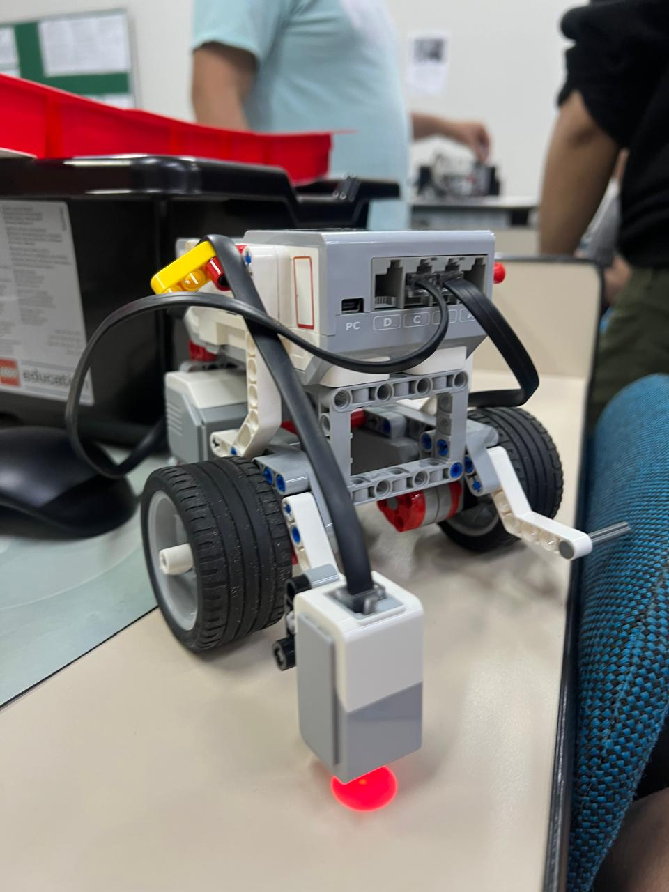

# 🤖 Projeto 1 — Seguidor de Linha

Projeto desenvolvido na disciplina de **Oficina de Programação e Robótica LEGO MINDSTORMS EV3 STEAM**, com o objetivo de construir e programar um robô capaz de percorrer autonomamente uma linha preta de 2 metros.

## 🎯 Objetivo

Desenvolver um robô capaz de identificar uma linha preta, acompanhar seu percurso e parar ao chegar exatamente ao final da pista.

Caso perdesse a trajetória durante o percurso, o robô deveria ser capaz de se relocalizar e continuar a execução.

## 🧩 Desafio

O desafio consistia em percorrer uma pista contendo uma linha preta de **2 metros**, utilizando sensores para identificar a trajetória e motores para controlar o deslocamento.

O robô deveria:

* Detectar a linha preta;
* Manter-se sobre a trajetória;
* Corrigir seu deslocamento quando necessário;
* Percorrer os 2 metros;
* Parar ao final do percurso.

## ⚙️ Hardware

* **LEGO MINDSTORMS EV3** — unidade de controle;
* **Bloco EV3** — execução do programa;
* **Motores B e C** — movimentação e controle da trajetória;
* **Sensor de cor (Sensor 4)** — identificação da linha por meio da leitura de intensidade luminosa;
* **Rodas e peças LEGO** — estrutura e locomoção;
* **Cabos** — conexão entre os componentes.

## 🧠 Lógica de funcionamento

O Sensor 4 realiza leituras da superfície da pista para identificar a faixa preta.

A partir dessas leituras, o programa utiliza estruturas de **decisão** para determinar o comportamento dos motores B e C.

Durante o desenvolvimento, a estratégia de movimentação passou por diferentes abordagens. Inicialmente, o robô realizava um movimento em **zigzag** para acompanhar a linha. Após os testes e ajustes, a solução evoluiu para uma trajetória mais direta e estável.

A parada ao final do percurso foi definida a partir de uma relação entre a **distância percorrida, velocidade dos motores e tempo de execução**, permitindo interromper o robô ao atingir o final da linha de 2 metros.

### Conceitos de programação utilizados

* Sequência;
* Estruturas condicionais;
* Laços de repetição;
* Leitura de sensores;
* Controle de motores;
* Lógica de controle de trajetória;
* Temporização.

## 🔧 Desenvolvimento e testes

A solução foi desenvolvida de forma iterativa, realizando testes e ajustes tanto na programação quanto na estrutura física do robô.

### Tentativa 1

O robô apresentava dificuldade para detectar corretamente a intensidade das cores e saía da trajetória.

**Ajuste:** priorização do acompanhamento da faixa preta, utilizando uma movimentação em zigzag.

### Tentativa 2

O robô conseguia acompanhar a linha, mas não realizava a parada corretamente ao final.

**Ajuste:** utilização de uma estimativa de distância percorrida associada ao tempo de execução.

### Tentativa 3

A trajetória foi ajustada para um deslocamento mais direto, com refinamento do comando de parada.

**Resultado:** a missão foi cumprida.

Além da programação, foram realizados ajustes na montagem para reforçar os encaixes das peças e melhorar a estabilidade do robô.

## 📐 Conceitos aplicados

O projeto envolveu conceitos de diferentes áreas:

**Programação e algoritmos**

* Sequência;
* Condicionais;
* Repetição;
* Sensoriamento;
* Controle de trajetória.

**Matemática e engenharia**

* Medição de distância;
* Cálculo de voltas das rodas;
* Controle de velocidade;
* Medição de ângulos;
* Distribuição de peso.

**Física**

* Atrito;
* Força;
* Centro de massa;
* Estabilidade.

## 🏆 Resultado

**Missão cumprida.**

O robô conseguiu percorrer autonomamente a linha preta de 2 metros e realizar a parada ao final do percurso.

O desenvolvimento também envolveu um processo de testes e refinamento da estratégia de controle, desde a movimentação em zigzag até uma trajetória mais estável.

## 📸 Registros do projeto

### Robô

### Programa

### Demonstração

A execução do projeto pode ser visualizada no vídeo abaixo:

[▶️ Assistir à demonstração](execucao.mp4)

## 🤝 Trabalho em equipe

Projeto acadêmico desenvolvido de forma colaborativa. Este repositório documenta o desafio, a solução construída e o resultado alcançado pela equipe; não deve ser interpretado como um projeto individual.

## 👥 Equipe

**Equipe Barca de Noé — Caixa 1**

* Juan J.
* Igor
* Gustavo R.
* Vitor C.
* Julia

**Data de conclusão:** 28/08/2026

## 📚 Contexto

Projeto desenvolvido como atividade prática da disciplina de **Oficina de Programação e Robótica LEGO MINDSTORMS EV3 STEAM**, utilizando conceitos de programação, robótica, matemática, engenharia e física.
